# 👋 Hi,
[](https://git.io/typing-svg)

### Full-Stack Developer | Flutter Developer | Agentic AI Enthusiast

I’m a developer who enjoys turning ideas into real-world applications. I work across **web, mobile, backend, and AI**, with a focus on building practical, scalable, and user-friendly software.

* 🚀 Developer of **Assets Realty**
* 📱 Developed the **Assets Realty mobile application** using Flutter
* 🌐 Built web applications using **React.js and Next.js**
* 🤖 Completed an **Agentic AI internship** focused on Python, FastAPI, Prompt Engineering, LangChain, RAG, Agents & LangGraph
* ☁️ Experience with Supabase, PostgreSQL, Docker and Vercel
* 🐧 Linux enthusiast

---

## 🚀 Featured Projects

### 🏠 Assets Realty

**Developer**

Assets Realty is a real-estate platform designed to help users discover and manage property-related services.

**My work:**

* Developed the Android application using **Flutter**
* Worked on the web platform using **React.js / Next.js**
* Built application features and integrations
* Contributed to the overall product development

📱 **Google Play:**
https://play.google.com/store/apps/details?id=com.rauttech.assets

🌐 **Website:**
https://assetsrealty.cc.cd/

---

🔧 The project includes a public-facing application platform and an administration system for managing applications and services.

---

### 🤖 Agentic AI Internship Projects

Completed an internship focused on **Agentic AI and modern AI application development**.

**Skills demonstrated:**

* Python Problem Solving
* FastAPI
* Prompt Engineering
* LangChain
* Retrieval-Augmented Generation (RAG)
* AI Agents
* LangGraph

📂 **Repository:**
https://github.com/RautTushar/internship_Agentic_AI

---

## 🛠️ Tech Stack

### Languages

<div style="display: flex; align-items: flex-start; align: center">
       <table align="center">
        <tr>
            <td align="center" width="96">
                <a href="#macropower-tech">
                    
                </a>
                <br>Python
            </td>
            <td align="center" width="96">
                
                <br>Java
            </td>
            <td align="center" width="96">
                
                <br>Go
            </td>
            <td align="center" width="96">
                
                <br>C
            </td>
            <td align="center" width="96">
                
                <br>JavaScript
            </td>
            <td align="center" width="96">
                
                <br>C++
            </td>
      </table>      

</div>


### Frontend & Mobile

<div style="display: flex; align-items: flex-start; align: center">
    <table align="center">
        <tr>
            <td align="center" width="96">
                <a href="#macropower-tech">
                    
                </a>
                <br>React
            </td>
             <td align="center" width="96">
                  <a href="https://skillicons.dev">
                
                      </a>
             <br>NextJS
            </td>
            <td align="center" width="96">
                  <a href="https://skillicons.dev">
                
                      </a>
             <br>flutter
            </td>
             <td align="center" width="96">
                  <a href="https://skillicons.dev">
                
                      </a>
             <br>HTML
             </td>
             <td align="center" width="96">
                  <a href="https://skillicons.dev">
                
                      </a>
             <br>CSS3
            </td>
            <td align="center" width="96">
                  <a href="https://skillicons.dev">
                
                      </a>
             <br>Tailwind CSS
            </td>
    </table> 
</div>   

### Backend, Database & Cloud

<div style="display: flex; align-items: flex-start; align: center">
    <table align="center">
        <tr>
            <td align="center" width="96">
                  <a href="https://skillicons.dev">
                
                      </a>
             <br>FastAPI
            </td>
            <td align="center" width="96">
                  <a href="https://skillicons.dev">
                
                      </a>
             <br>PostgreSQL
            </td>
            <td align="center" width="96">
                  <a href="https://skillicons.dev">
                
                      </a>
             <br>Supabase
            </td>
            <td align="center" width="96">
                <a href="#macropower-tech">
                    
                </a>
                <br>Docker
            </td>
            <td align="center" width="96">
                  <a href="https://skillicons.dev">
                
                      </a>
             <br>Vercel
    </table>
</div>

### Tools & Environment

<div style="display: flex; align-items: flex-start; align: center">
    <table align="center">
        <tr>
            <td align="center" width="96">
                  <a href="https://skillicons.dev">
                
                      </a>
             <br>Git
            </td>
            <td align="center" width="96">
                  <a href="https://skillicons.dev">
                
                      </a>
             <br>Github
            </td>
            <td align="center" width="96">
                  <a href="https://skillicons.dev">
                
                      </a>
             <br>vscode
            </td>
            <td align="center" width="96">
                  <a href="https://skillicons.dev">
                
                      </a>
             <br>Vim
            </td>
            <td align="center" width="96">
                  <a href="https://skillicons.dev">
                
                      </a>
             <br>Linux
            </td>
            <td align="center" width="96">
                  <a href="https://skillicons.dev">
                
                      </a>
             <br>Arch
             <td align="center" width="96">
                  <a href="https://skillicons.dev">
                
                      </a>
             <br>Redhat
            </td>
    </table>
</div>

### AI & Intelligent Systems

<div style="display: flex; align-items: flex-start; align: center">
    <table align="center">
        <tr>
        <td align="center" width="96">
         <a href="https://go-skill-icons.netlify.app">
         
         </a>
         <br>DeepSeek
         </td>
         <td align="center" width="96">
         <a href="https://go-skill-icons.netlify.app">
         
         </a>
         <br>Gemini
         </td>
         <td align="center" width="96">
         <a href="https://go-skill-icons.netlify.app">
         
         </a>
         <br>Claude
         </td>
         <td align="center" width="96">
         <a href="https://go-skill-icons.netlify.app">
         
         </a>
         <br>ChatGPT
         </td>
    </table>
</div> 


### AI / LLM


---

## 🌱 Currently Learning

* Advanced Agentic AI architectures
* LLM application development
* RAG optimization
* Backend architecture
* Scalable web applications
* Cloud & DevOps
* System design

---

## 💼 Experience

### Agentic AI Internship

Completed an internship focused on modern AI engineering and agentic application development.

**Core areas:**

`Python` · `Problem Solving` · `FastAPI` · `Prompt Engineering` · `LangChain` · `RAG` · `Agents` · `LangGraph`

### Assets Realty

**Developer**

Responsible for developing the company's mobile application and contributing to its web platform and product development.

---

## 📊 GitHub

<p align="center">
  
  
</p>

<p align="center">
  
</p>

---

## 🐍 Contribution Graph

<picture>
  <source media="(prefers-color-scheme: dark)"
          srcset="https://raw.githubusercontent.com/RautTushar/RautTushar/output/github-contribution-grid-snake-dark.svg" />
  <source media="(prefers-color-scheme: light)"
          srcset="https://raw.githubusercontent.com/RautTushar/RautTushar/output/github-contribution-grid-snake.svg" />
  
</picture>

---

## 📫 Connect With Me

<div style="display: flex; align-items: flex-start; align: center">
    <table>
        <tr>
        <td align="center">
         
<a href="https://www.linkedin.com/in/https://www.linkedin.com/in/tushar-raut-67347a315//" target="_blank">
  
</a>
         <br>Linkedin
         </td>
         <td align="center">
         
<a href="mailto:traut632021@gmail.com">
  
</a>
         <br>Mail
         </td>
    </table>
</div> 

---

## ⚡ A Little About Me

```text
💡 I like building useful products
🧠 I enjoy solving technical problems
🤖 I'm exploring the future of Agentic AI
📱 I build mobile applications with Flutter
🌐 I build modern web applications with React & Next.js
🔧 I enjoy working across the full development stack
```

---

### 💬 My Philosophy

> **Build real products. Keep learning. Solve real problems.**

⭐ Feel free to explore my repositories and follow my development journey.


<p align="center">
  
</p>
